<div align="center">

<p>
  <a href="README.md">English</a> · <strong>Bahasa Indonesia</strong>
</p>

# BukuKita

**Katalog Toko Buku Editorial Modern & Asisten Katalog AI untuk Android**

Aplikasi Android native dwibahasa (Bahasa Indonesia & Inggris) untuk katalog buku dan asisten pencarian buku berbasis AI yang dirancang bagi **Toko Buku Semut Alas** (Malang), dibangun dengan Jetpack Compose, Material Design 3, Supabase, dan Google Gemini API.

[](https://kotlinlang.org/)
[](https://developer.android.com/compose)
[](https://developer.android.com/)
[](https://supabase.com/)
[](https://ai.google.dev/)

<br />

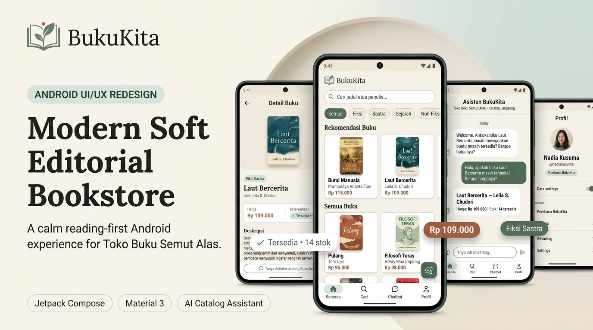

</div>

---

## Ringkasan Proyek

**BukuKita** memperluas layanan **Toko Buku Semut Alas** (*Jl. Raya Tlogomas No.18, Malang · 09:00–21:00*) melampaui jam operasional toko fisik dengan menggabungkan katalog buku digital yang tenang dan nyaman dibaca bersama asisten AI yang terhubung langsung ke data inventaris katalog.

Awalnya dikembangkan sebagai Tugas Akhir / Skripsi dengan fokus pada layanan pelanggan berbasis AI yang *grounded* pada basis data serta aliran data mobile yang responsif, aplikasi ini kemudian didesain ulang sepenuhnya dengan konsep **Modern Soft Editorial Bookstore** — menggantikan templat Material generik dengan sistem token desain tiga lapis untuk Mode Terang & Gelap, tipografi editorial bawaan, dan kontras warna terverifikasi WCAG AA.

> **Batasan ruang lingkup:** BukuKita berfokus pada penjelajahan katalog, pencarian buku, dan layanan tanya-jawab berbasis AI. Fitur transaksi pembelian dan pembayaran di dalam aplikasi tidak disertakan pada versi ini.

---

## Fitur Utama & Showcase

### 1. Katalog & Penemuan Buku

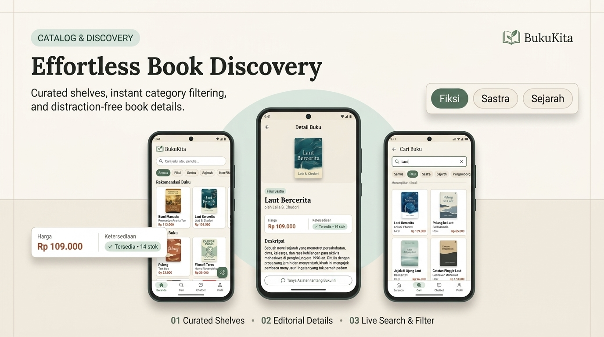

- **Rak Beranda Terkurasi:** Rak rekomendasi horizontal (*Rekomendasi Buku*) dan grid katalog dua kolom (*Semua Buku*) yang tersinkronisasi langsung dengan data buku Supabase, dilengkapi pemuatan sampul via Coil dan *shimmer skeleton* bernuansa linen hangat.
- **Pencarian Langsung & Filter Kategori:** Pencarian judul secara *real-time* dengan *debounce* `StateFlow` 500 md yang dipadukan dengan pil filter kategori dinamis, ilustrasi botani untuk kondisi kosong, serta tampilan galat yang dapat dimuat ulang.
- **Detail Buku Editorial:** Tampilan sampul berbingkai, harga Rupiah beraksen terakota hangat, lencana ketersediaan stok (*Tersedia* / *Stok habis*), sinopsis lengkap, serta tombol satu ketukan **"Tanya Asisten tentang Buku Ini"** yang langsung mengisi pertanyaan ke chatbot AI.

---

### 2. Asisten Toko Buku AI (*Asisten BukuKita*)

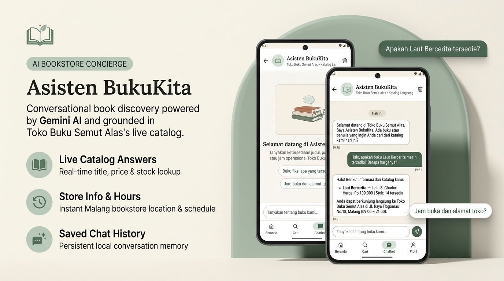

- **Grounding Katalog Langsung:** Membersihkan sapaan percakapan dari pertanyaan pengguna, menjalankan pencarian *multi-keyword* `ilike` pada `title` dan `author` di Supabase (hingga 20 buku yang relevan), lalu menyuntikkan harga, jumlah stok, dan jam buka toko secara langsung ke *prompt* **Gemini (`gemini-3.1-flash-lite`)** dengan temperatur rendah (`0.1`).
- **Memori Percakapan Persisten:** Menyimpan riwayat obrolan per pengguna secara lokal di **Room SQLite** (`bukukita_database`), mengirimkan 6 pesan terakhir demi kesinambungan konteks, serta menyediakan opsi hapus riwayat dengan dialog konfirmasi.
- **Panduan & Batasan Terukur:** Dilengkapi layar sambutan berilustrasi dengan tombol saran pertanyaan cepat dan respons yang mengikuti bahasa aplikasi yang aktif. Karena AI generatif tetap dapat keliru menafsirkan konteks, informasi penting seperti stok dan harga sebaiknya tetap dicek ulang pada halaman katalog.

---

### 3. Akun Pembaca & Personalisasi

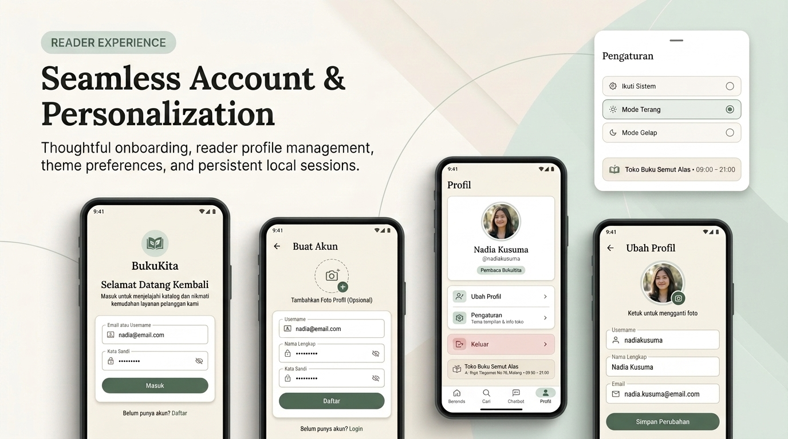

- **Autentikasi Fleksibel:** Masuk menggunakan **email atau username** (dicocokkan melalui tabel `profiles` Supabase) dengan sesi lokal persisten berbasis Supabase GoTrue Auth dan `SharedPreferences`.
- **Manajemen Profil & Avatar:** Registrasi akun lengkap dan ubah profil (`username`, `full_name`, `email`) dengan unggah foto profil opsional langsung ke Supabase Storage (bucket `avatars`).
- **Tema, Bahasa & Info Toko:** Ganti bahasa antara **Bahasa Indonesia** dan **English** langsung dari layar Masuk atau lembar Pengaturan, pilih `ThemeMode` persisten (*Ikuti Sistem*, *Mode Terang*, *Mode Gelap*), serta akses cepat alamat dan jam buka Toko Buku Semut Alas.

---

## Sistem Desain & Detail Visual

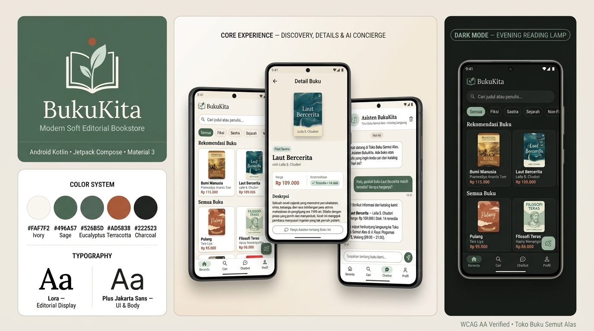

Dirancang dari awal sebagai sistem desain tiga lapis yang terdokumentasi ([`design/design-system.md`](design/design-system.md)):

- **Paper & Sage (Terang) + Evening Reading Lamp (Gelap):** Gading hangat (`#FAF7F2`), hijau sage lembut (`#496A57`), eucalyptus (`#526B5D`), dan terakota hangat (`#AD5838`) untuk Mode Terang — dipasangkan dengan palet arang hutan (`#161917`) dan sage bercahaya (`#9BC0A9`) khusus untuk Mode Gelap.
- **Tipografi Editorial:** Font bawaan **`Lora`** serif untuk nama merek, judul layar, dan subjudul bagian, dipadukan dengan **`Plus Jakarta Sans`** untuk kontrol antarmuka, metadata, dan teks percakapan yang tajam.
- **Aksesibilitas Terverifikasi:** Seluruh pasangan warna teks dan latar semantik untuk Mode Terang dan Gelap diverifikasi secara matematis memenuhi **WCAG 2.1 AA (`>= 4.5:1`)** pada [`DesignTokenContrastTest.kt`](app/src/test/java/com/example/bukukita/ui/DesignTokenContrastTest.kt), disertai target sentuh minimal 48dp, dukungan *edge-to-edge*, deteksi *reduced motion*, dan pengujian QA skala font 1.3x.

### Tangkapan Layar Emulator Android

Tangkapan layar runtime Jetpack Compose asli yang dihasilkan oleh rangkaian uji QA visual otomatis ([`BukuKitaVisualQaTest.kt`](app/src/androidTest/java/com/example/bukukita/ui/BukuKitaVisualQaTest.kt)):

| Beranda (Terang) | Beranda (Gelap) | Detail Buku | Chatbot AI |
| :---: | :---: | :---: | :---: |
| 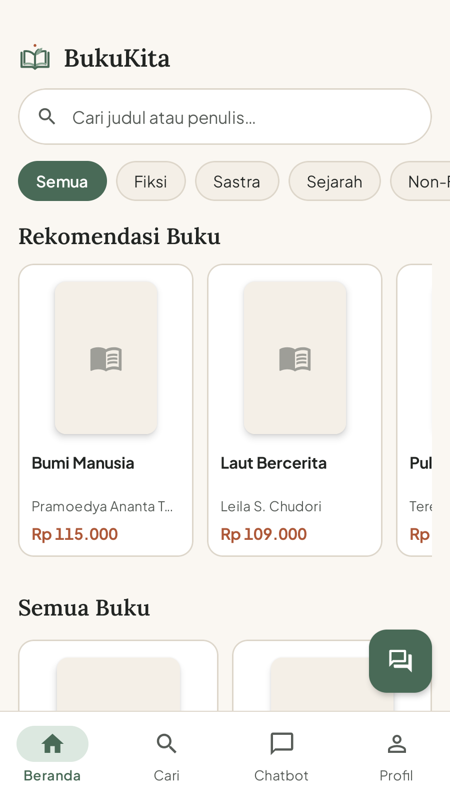 | 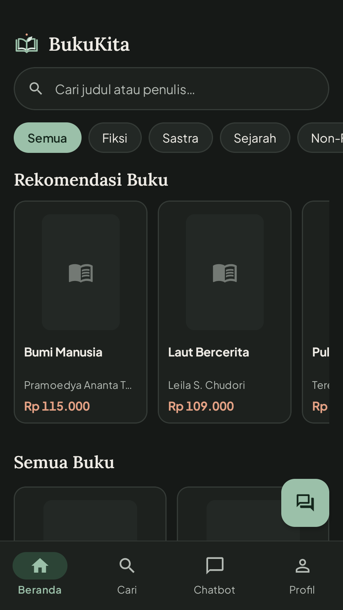 | 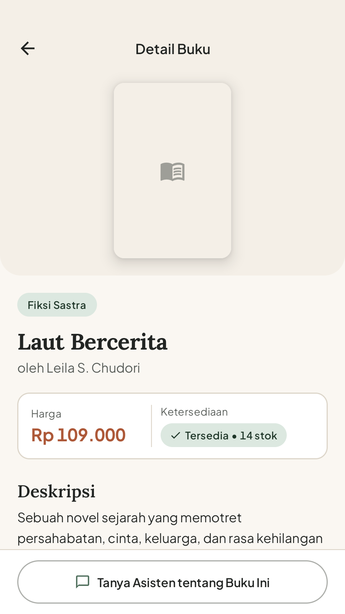 | 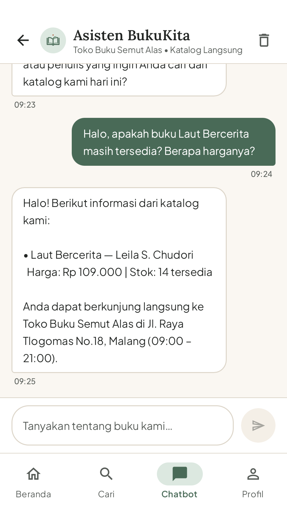 |

<details>
<summary>Lihat tangkapan layar emulator lainnya (Pencarian, Kondisi Kosong, Sambutan Chatbot, Masuk, Profil &amp; Pengaturan)</summary>

<br />

| Pencarian Langsung | Pencarian Kosong | Sambutan Chatbot |
| :---: | :---: | :---: |
| 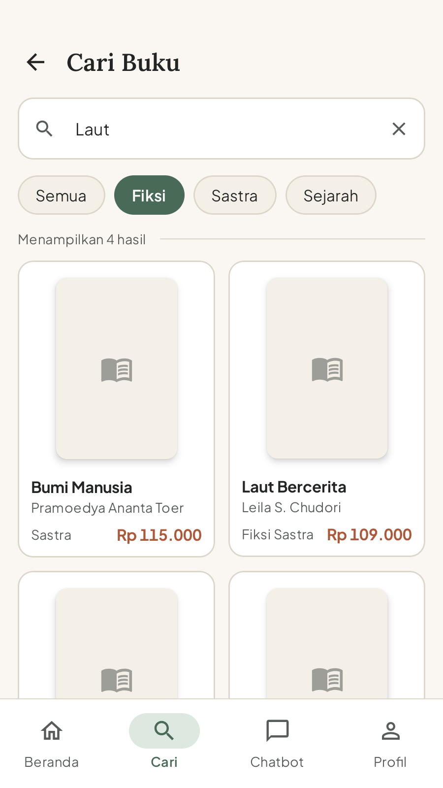 | 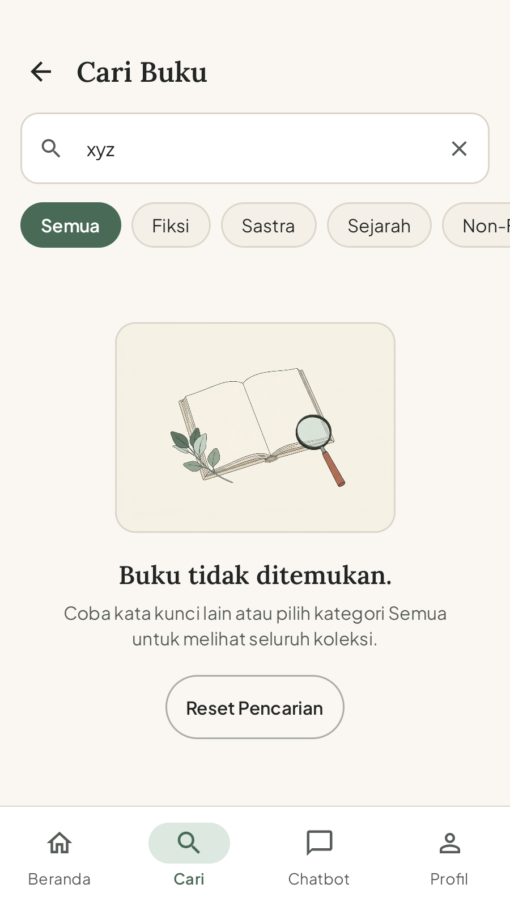 | 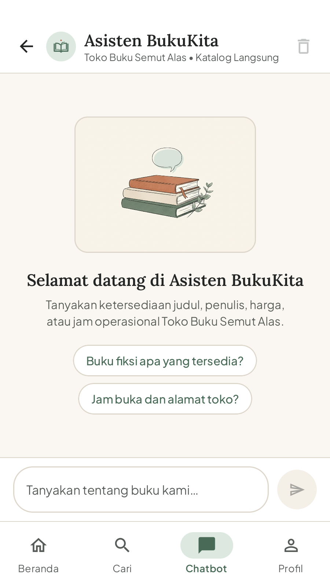 |

| Masuk | Profil Pembaca | Lembar Pengaturan |
| :---: | :---: | :---: |
| 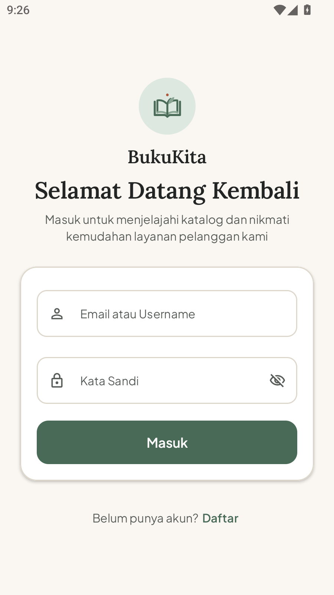 | 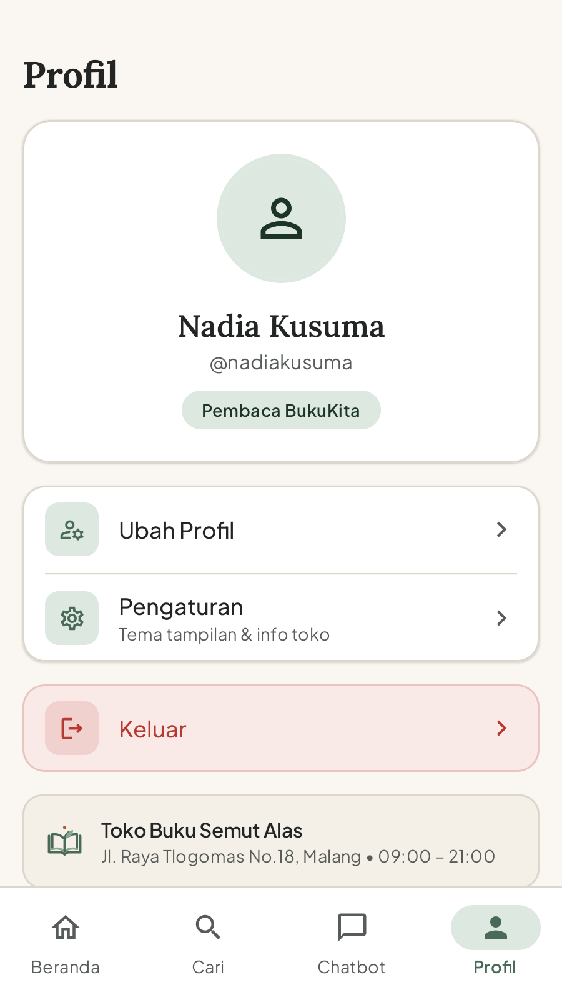 | 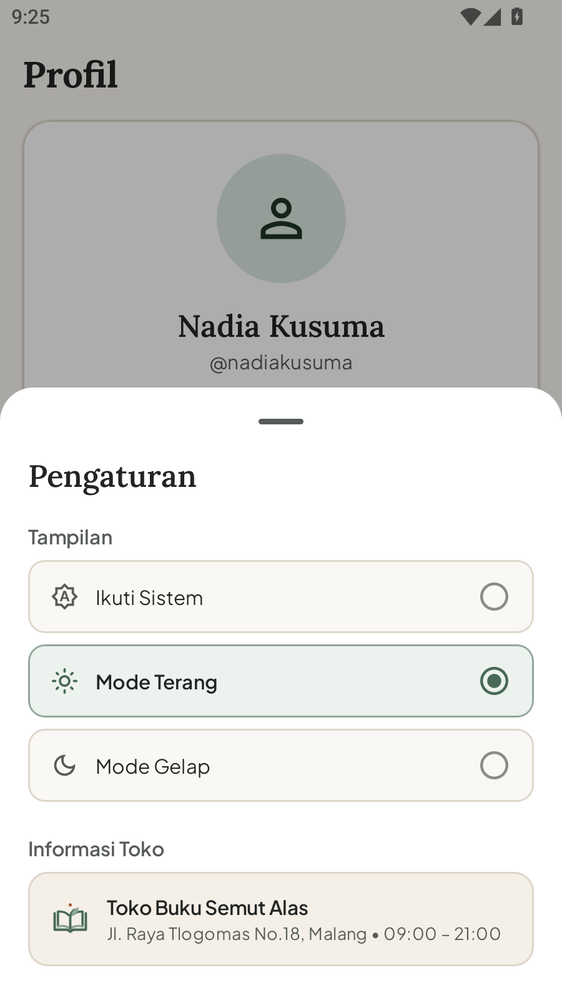 |

</details>

---

## Arsitektur & Teknologi

BukuKita menerapkan arsitektur **MVVM + Repository** pada satu `Activity` Jetpack Compose `NavHost` dengan pengelolaan state searah menggunakan `StateFlow`:

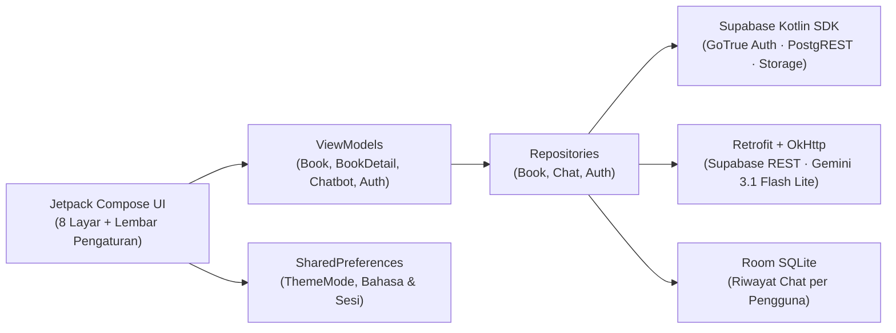

| Lapisan | Teknologi |
| :--- | :--- |
| **Bahasa & Platform** | Kotlin `2.2.10`, Android SDK (`minSdk 28`, `targetSdk 36`), AGP `9.1.0`, KSP |
| **UI & Navigasi** | Jetpack Compose (BOM `2024.09.00`), Material Design 3, Navigation Compose `2.7.7`, Coil `2.6.0` |
| **State & Konkurensi** | AndroidX Lifecycle ViewModel Compose `2.8.2`, Kotlin Coroutines & `StateFlow` |
| **Mesin AI** | Google Gemini API (`gemini-3.1-flash-lite`) melalui Retrofit `2.11.0` + Gson |
| **Layanan Backend** | Supabase Kotlin SDK `2.6.0` (`gotrue-kt`, `postgrest-kt`, `storage-kt`, Ktor OkHttp `2.3.12`) & Supabase PostgREST |
| **Penyimpanan Lokal** | Room `2.8.4` (`bukukita_database`), Android `SharedPreferences` |
| **Pengujian & QA** | JUnit 4 (kontras WCAG & helper domain), Jetpack Compose UI Test & rangkaian QA Visual Emulator |

### Struktur Proyek

```text
BukuKita/
├── app/src/
│   ├── main/java/com/example/bukukita/
│   │   ├── data/
│   │   │   ├── model/         # Book, UserProfile, GeminiModels, Room AppDatabase & DAO
│   │   │   ├── remote/        # ApiClient, SupabaseApiService, GeminiApiService, ApiConfig (lokal)
│   │   │   └── repository/    # BookRepository, AuthRepository, ChatRepository
│   │   ├── ui/
│   │   │   ├── auth/          # LoginScreen, RegisterScreen
│   │   │   ├── home/          # HomeScreen (rak rekomendasi + grid katalog)
│   │   │   ├── search/        # SearchScreen (pencarian langsung + filter kategori)
│   │   │   ├── detail/        # BookDetailScreen + pintasan ke chatbot
│   │   │   ├── chatbot/       # ChatbotScreen (sambutan + obrolan grounded katalog)
│   │   │   ├── profile/       # ProfileScreen, EditProfileScreen, SettingsSheet
│   │   │   ├── components/    # Kartu editorial, chip, input, bottom bar, shimmer/empty state
│   │   │   └── theme/         # Token Terang/Gelap 3 lapis, Tipografi, Spasi, Motion, Preferensi Tema & Bahasa
│   │   ├── utils/             # Pemformat mata uang Rupiah & waktu obrolan
│   │   ├── viewmodel/         # BookViewModel, BookDetailViewModel, ChatbotViewModel, AuthViewModel
│   │   ├── BukuKitaApplication.kt
│   │   └── MainActivity.kt    # Compose NavHost edge-to-edge & transisi layar
│   ├── test/                  # Unit test JVM (kontras WCAG AA + helper)
│   └── androidTest/           # Uji komponen Compose & tangkapan layar QA visual
└── design/
    ├── design-system.md       # Spesifikasi lengkap token desain 3 lapis & komponen editorial
    ├── redesign-plan.md       # Cetak biru implementasi & daftar periksa QA
    ├── portfolio-showcase/    # Banner presentasi resolusi tinggi
    └── qa_screenshots/        # Tangkapan layar QA emulator Android asli
```

---

## Menjalankan Proyek

### Prasyarat

- **Android Studio** yang mendukung AGP `9.1.0` dan JDK 11+
- Emulator atau perangkat Android dengan **Android 9.0 (API 28)** atau lebih tinggi
- Proyek **Supabase** dan kunci API **Google AI Studio (Gemini)**

### 1. Clone Repositori

```bash
git clone https://github.com/Zaacodez/BukuKita.git
cd BukuKita
```

### 2. Siapkan Skema & Storage Supabase

Buat sumber daya berikut di proyek Supabase Anda:

- **Tabel `books`:** `id`, `title`, `author`, `price`, `description`, `category`, `cover_url`, `stock`, `created_at`
- **Tabel `profiles`:** `id`, `username`, `full_name`, `email`, `avatar_url` (dengan *trigger* registrasi Auth yang otomatis membuat baris profil)
- **Bucket `avatars`:** Bucket publik Supabase Storage untuk foto profil pembaca

### 3. Tambahkan Konfigurasi API Lokal

`ApiConfig.kt` dikecualikan dari git melalui `.gitignore`. Buat berkas tersebut secara lokal di:

`app/src/main/java/com/example/bukukita/data/remote/ApiConfig.kt`

```kotlin
package com.example.bukukita.data.remote

object ApiConfig {
    const val SUPABASE_URL = "https://your-project.supabase.co/"
    const val SUPABASE_ANON_KEY = "your-supabase-anon-key"
    const val GEMINI_API_KEY = "your-gemini-api-key"
}
```

> Pastikan `SUPABASE_URL` diakhiri garis miring `/` (dibutuhkan oleh *base URL builder* Retrofit), dan jangan pernah meng-commit kredensial asli ke repositori publik.

### 4. Build & Jalankan Pengujian

Buka proyek di Android Studio lalu klik **Run**, atau gunakan Gradle wrapper:

```bash
# Build APK debug
./gradlew assembleDebug

# Jalankan unit test JVM (rasio kontras WCAG, helper kategori & stok)
./gradlew testDebugUnitTest

# Jalankan uji UI Compose terinstrumentasi pada emulator/perangkat terhubung
./gradlew connectedDebugAndroidTest
```

---

## Dokumentasi Desain

- **[Spesifikasi Sistem Desain](design/design-system.md)** — Palet warna primitif/semantik lengkap, skala tipografi, hierarki spasi/bentuk, serta tabel verifikasi kontras WCAG.
- **[Cetak Biru Redesign](design/redesign-plan.md)** — Arsitektur tiap layar dan daftar periksa QA visual.
