<div align="center">

# BukuKita

**Modern Soft Editorial Bookstore & AI Catalog Assistant for Android**

A native Bahasa Indonesia Android bookstore catalog and conversational AI book assistant built for **Toko Buku Semut Alas** (Malang), crafted with Jetpack Compose, Material Design 3, Supabase, and the Google Gemini API.

[](https://kotlinlang.org/)
[](https://developer.android.com/compose)
[](https://developer.android.com/)
[](https://supabase.com/)
[](https://ai.google.dev/)

<br />

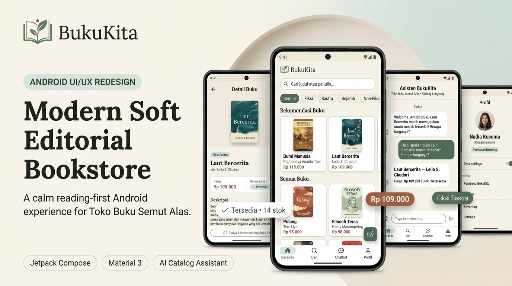

</div>

---

## Overview

**BukuKita** extends the customer experience of **Toko Buku Semut Alas** (*Jl. Raya Tlogomas No.18, Malang · 09:00–21:00*) beyond store hours by pairing a calm, reading-first digital book catalog with an AI bookstore concierge grounded in live inventory data.

Originally built as an undergraduate thesis (*Tugas Akhir / Skripsi*) focused on grounded AI customer service and responsive mobile data flow, the application underwent a complete **Modern Soft Editorial Bookstore** UI/UX redesign — replacing generic Material templates with a three-layer Light & Dark design token system, bundled editorial typography, and WCAG AA-verified contrast.

> **Scope note:** BukuKita focuses on catalog browsing, search, and AI-assisted book inquiries. In-app checkout and payment processing are intentionally excluded from this version.

---

## Key Features & Showcase

### 1. Catalog & Discovery

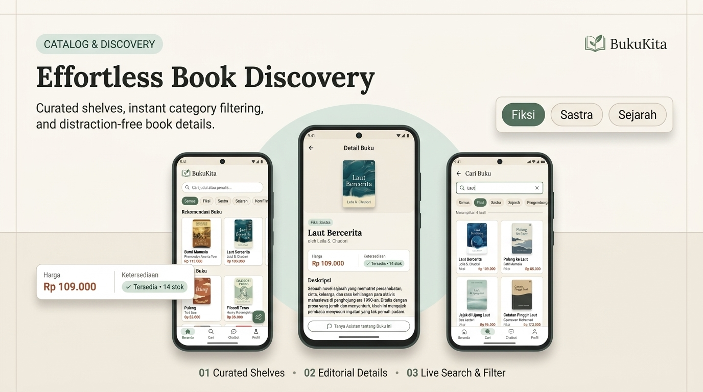

- **Curated Home Shelves:** Horizontal recommendation shelf (*Rekomendasi Buku*) and two-column catalog grid (*Semua Buku*) backed by live Supabase book data with Coil cover rendering and warm linen shimmer skeletons.
- **Debounced Live Search & Category Filtering:** Real-time title search (500ms `StateFlow` debounce) combined with dynamically loaded category filter pills, empty-state botanical illustrations, and recoverable error states.
- **Editorial Book Details:** Framed cover showcase, Rupiah pricing in warm terracotta, live stock availability badge (*Tersedia* / *Stok habis*), full synopsis, and a one-tap **"Tanya Asisten tentang Buku Ini"** action that hands a pre-filled question directly to the AI assistant.

---

### 2. AI Bookstore Concierge (*Asisten BukuKita*)

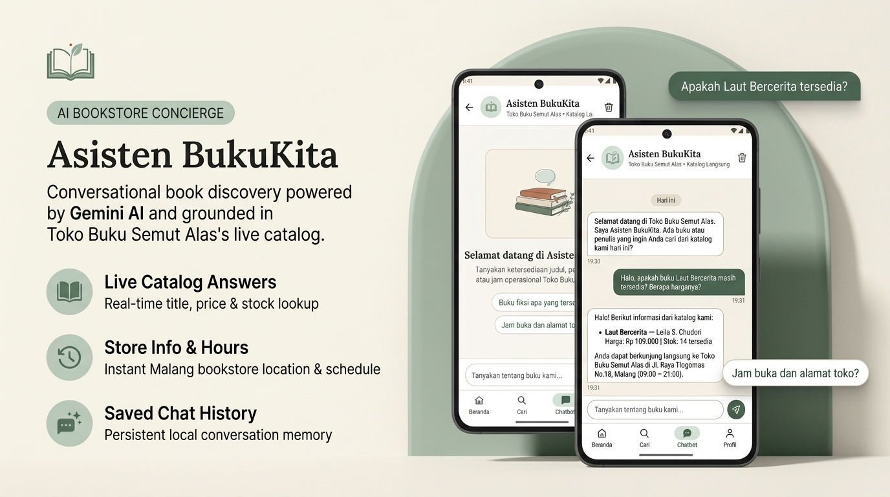

- **Live Catalog Grounding:** Strips conversational greetings from user queries, performs multi-keyword `ilike` recall across book `title` and `author` in Supabase (up to 20 matching records), and injects live prices, stock counts, and store hours into a strict low-temperature (`0.1`) **Gemini (`gemini-3.1-flash-lite`)** prompt.
- **Persistent Multi-Turn Memory:** Stores per-user conversation history locally in **Room SQLite** (`bukukita_database`), passes the last 6 messages for conversational continuity, and supports one-tap history reset with confirmation.
- **Thoughtful Guardrails:** Includes an illustrated welcome screen with starter prompt chips and Bahasa Indonesia input checks. Because generative AI can still misinterpret context, critical details like stock and pricing should always be cross-checked against the catalog view.

---

### 3. Reader Accounts & Personalization

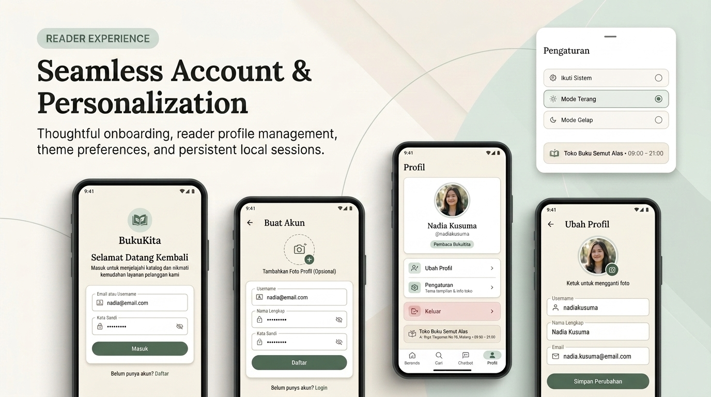

- **Flexible Authentication:** Sign in using either **email or username** (resolved via Supabase `profiles`) with persistent local sessions powered by Supabase GoTrue Auth and `SharedPreferences`.
- **Profile & Avatar Management:** Full account registration and profile editing (`username`, `full_name`, `email`) with optional profile photo uploads directly to Supabase Storage (`avatars` bucket).
- **Theme Personalization & Store Info:** Modal Settings sheet with persisted `ThemeMode` selection (*Ikuti Sistem*, *Mode Terang*, *Mode Gelap*) and quick access to Toko Buku Semut Alas store hours and address.

---

## Design System & Visual Craft

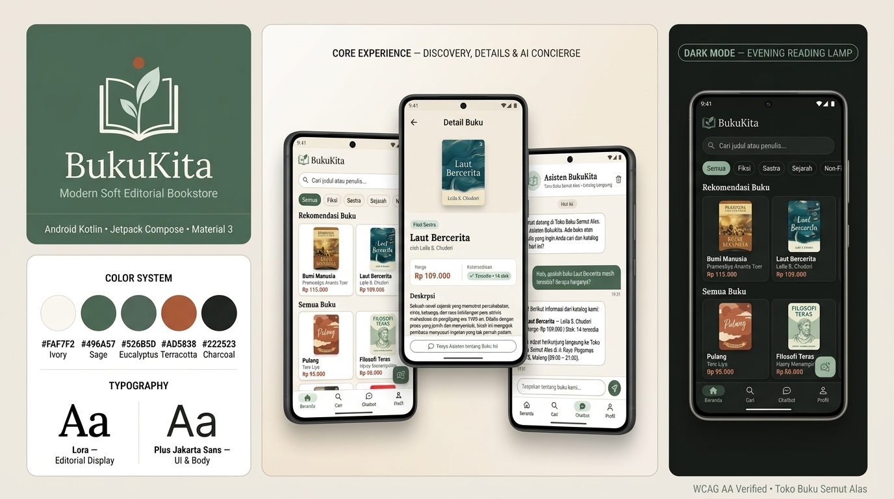

Built from scratch as a documented three-layer design system ([`design/design-system.md`](design/design-system.md)):

- **Paper & Sage (Light) + Evening Reading Lamp (Dark):** Warm unbleached ivory (`#FAF7F2`), soft sage (`#496A57`), muted eucalyptus (`#526B5D`), and warm terracotta (`#AD5838`) for Light mode — paired with a dedicated forest-charcoal (`#161917`) and luminous sage (`#9BC0A9`) Dark palette.
- **Editorial Typography:** Bundled **`Lora`** serif for brand wordmarks, screen titles, and section headings paired with **`Plus Jakarta Sans`** for crisp UI controls, metadata, and chat copy.
- **Verified Accessibility:** Every semantic Light and Dark foreground/background token pair is mathematically verified to meet **WCAG 2.1 AA (`>= 4.5:1`)** in [`DesignTokenContrastTest.kt`](app/src/test/java/com/example/bukukita/ui/DesignTokenContrastTest.kt), alongside 48dp minimum touch targets, edge-to-edge system bars, reduced-motion awareness, and 1.3x font-scale QA.

### Live Android Emulator Captures

Actual Jetpack Compose runtime screenshots captured by the automated visual QA test suite ([`BukuKitaVisualQaTest.kt`](app/src/androidTest/java/com/example/bukukita/ui/BukuKitaVisualQaTest.kt)):

| Home (Light) | Home (Dark) | Book Detail | AI Chatbot |
| :---: | :---: | :---: | :---: |
| 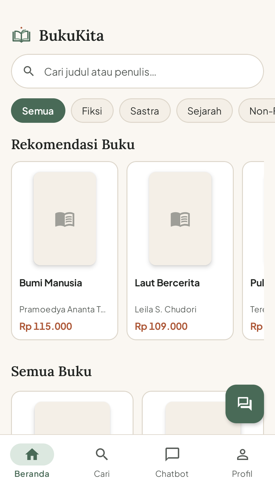 | 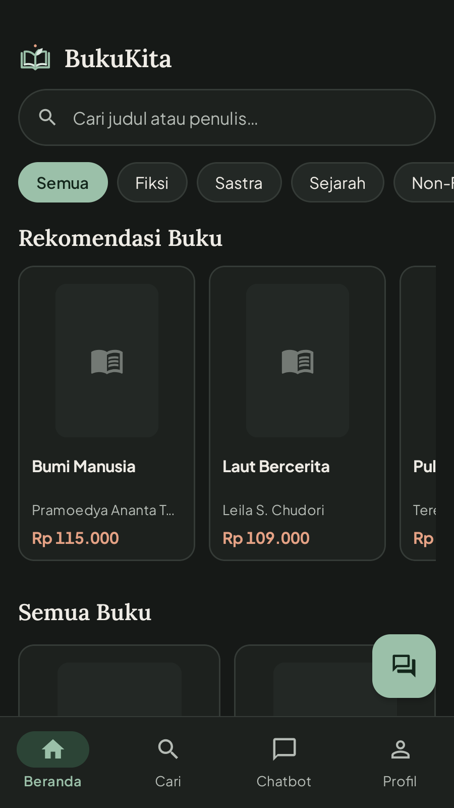 | 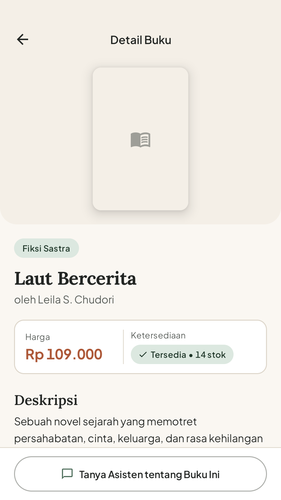 | 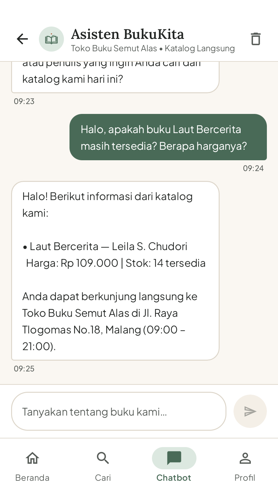 |

<details>
<summary>View more live emulator captures (Search, Empty State, Chatbot Welcome, Login, Profile &amp; Settings)</summary>

<br />

| Live Search | Empty Search State | Chatbot Welcome |
| :---: | :---: | :---: |
| 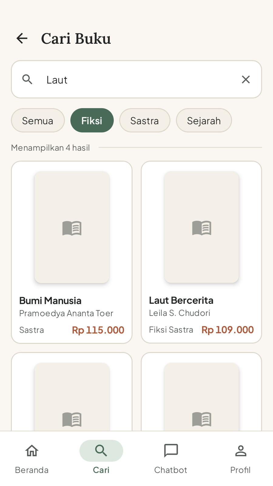 | 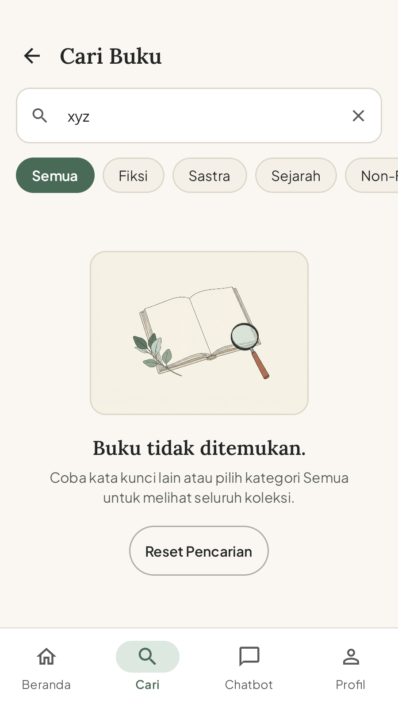 | 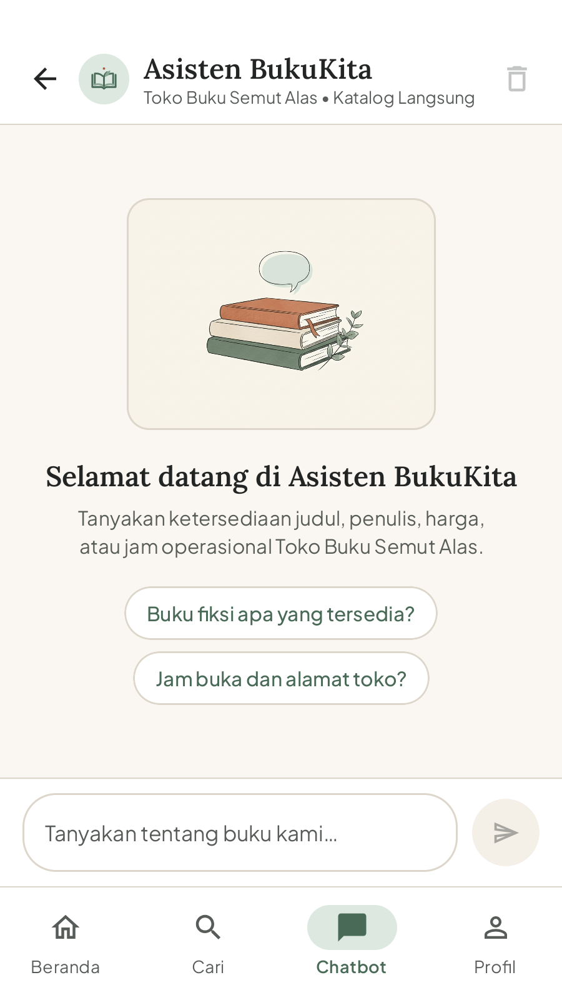 |

| Login | Reader Profile | Settings Sheet |
| :---: | :---: | :---: |
| 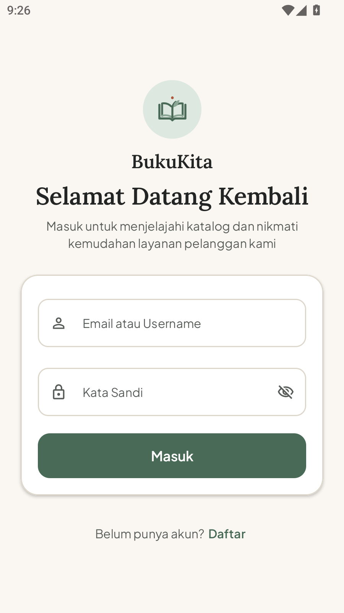 | 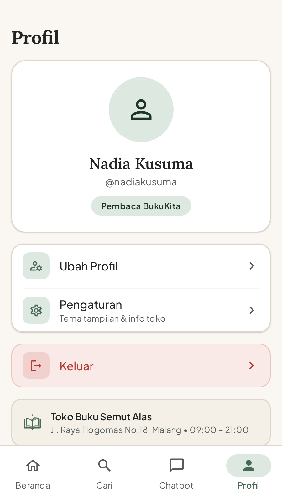 | 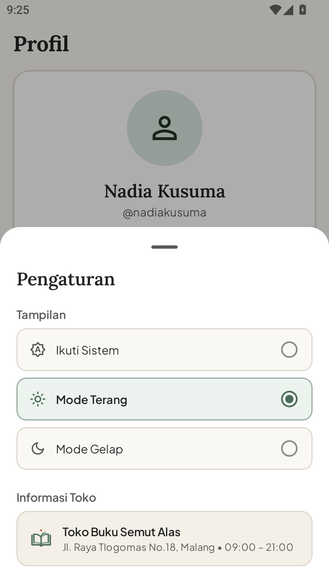 |

</details>

---

## Architecture & Tech Stack

BukuKita follows an **MVVM + Repository** architecture on a single-activity Jetpack Compose `NavHost` with unidirectional `StateFlow` state management:

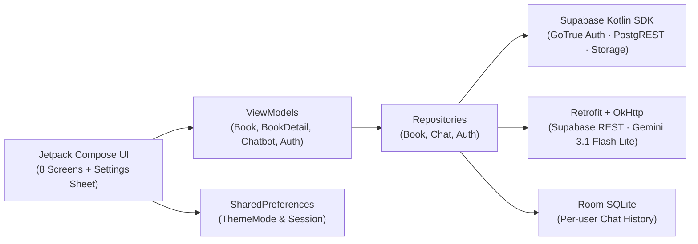

| Layer | Technologies |
| :--- | :--- |
| **Language & Platform** | Kotlin `2.2.10`, Android SDK (`minSdk 28`, `targetSdk 36`), AGP `9.1.0`, KSP |
| **UI & Navigation** | Jetpack Compose (BOM `2024.09.00`), Material Design 3, Navigation Compose `2.7.7`, Coil `2.6.0` |
| **State & Concurrency** | AndroidX Lifecycle ViewModel Compose `2.8.2`, Kotlin Coroutines & `StateFlow` |
| **AI Engine** | Google Gemini API (`gemini-3.1-flash-lite`) via Retrofit `2.11.0` + Gson |
| **Backend Services** | Supabase Kotlin SDK `2.6.0` (`gotrue-kt`, `postgrest-kt`, `storage-kt`, Ktor OkHttp `2.3.12`) & Supabase PostgREST |
| **Local Persistence** | Room `2.8.4` (`bukukita_database`), Android `SharedPreferences` |
| **Testing & QA** | JUnit 4 (WCAG contrast & domain helpers), Jetpack Compose UI Test & Emulator Visual QA suite |

### Project Structure

```text
BukuKita/
├── app/src/
│   ├── main/java/com/example/bukukita/
│   │   ├── data/
│   │   │   ├── model/         # Book, UserProfile, GeminiModels, Room AppDatabase & DAO
│   │   │   ├── remote/        # ApiClient, SupabaseApiService, GeminiApiService, ApiConfig (local)
│   │   │   └── repository/    # BookRepository, AuthRepository, ChatRepository
│   │   ├── ui/
│   │   │   ├── auth/          # LoginScreen, RegisterScreen
│   │   │   ├── home/          # HomeScreen (curated shelf + catalog grid)
│   │   │   ├── search/        # SearchScreen (live search + category filters)
│   │   │   ├── detail/        # BookDetailScreen + chatbot handoff
│   │   │   ├── chatbot/       # ChatbotScreen (welcome state + grounded chat)
│   │   │   ├── profile/       # ProfileScreen, EditProfileScreen, SettingsSheet
│   │   │   ├── components/    # Shared editorial cards, chips, inputs, bottom bar, shimmer/states
│   │   │   └── theme/         # 3-layer Light/Dark tokens, Typography, Spacing, Motion, ThemePreference
│   │   ├── utils/             # Rupiah currency & chat timestamp formatters
│   │   ├── viewmodel/         # BookViewModel, BookDetailViewModel, ChatbotViewModel, AuthViewModel
│   │   ├── BukuKitaApplication.kt
│   │   └── MainActivity.kt    # Edge-to-edge Compose NavHost & transition choreography
│   ├── test/                  # JVM unit tests (WCAG AA contrast + helpers)
│   └── androidTest/           # Compose component & visual QA screenshot tests
└── design/
    ├── design-system.md       # Full 3-layer design token & editorial component specification
    ├── redesign-plan.md       # Implementation & QA blueprint
    ├── portfolio-showcase/    # High-resolution presentation banners
    └── qa_screenshots/        # Real Android emulator QA captures
```

---

## Getting Started

### Prerequisites

- **Android Studio** supporting AGP `9.1.0` and JDK 11+
- An Android emulator or physical device running **Android 9.0 (API 28)** or higher
- A **Supabase** project and a **Google AI Studio (Gemini)** API key

### 1. Clone the Repository

```bash
git clone https://github.com/Zaacodez/BukuKita.git
cd BukuKita
```

### 2. Configure Supabase Schema & Storage

Set up the following resources in your Supabase project:

- **`books` table:** `id`, `title`, `author`, `price`, `description`, `category`, `cover_url`, `stock`, `created_at`
- **`profiles` table:** `id`, `username`, `full_name`, `email`, `avatar_url` (with an Auth sign-up trigger that inserts a matching profile row)
- **`avatars` bucket:** Public Supabase Storage bucket for reader profile photos

### 3. Add Local API Configuration

`ApiConfig.kt` is excluded from version control via `.gitignore`. Create it locally at:

`app/src/main/java/com/example/bukukita/data/remote/ApiConfig.kt`

```kotlin
package com.example.bukukita.data.remote

object ApiConfig {
    const val SUPABASE_URL = "https://your-project.supabase.co/"
    const val SUPABASE_ANON_KEY = "your-supabase-anon-key"
    const val GEMINI_API_KEY = "your-gemini-api-key"
}
```

> Keep the trailing `/` on `SUPABASE_URL` (required by Retrofit's base URL builder), and never commit real credentials to a public repository.

### 4. Build & Run Tests

Open the project in Android Studio and click **Run**, or use the Gradle wrapper:

```bash
# Build debug APK
./gradlew assembleDebug

# Run JVM unit tests (WCAG contrast ratios, category & stock helpers)
./gradlew testDebugUnitTest

# Run instrumented Compose UI tests on a connected emulator/device
./gradlew connectedDebugAndroidTest
```

---

## Design Documentation

- **[Design System Specification](design/design-system.md)** — Full primitive/semantic color palette, typography scale, spacing/shape hierarchy, and WCAG contrast verification table.
- **[Redesign Blueprint](design/redesign-plan.md)** — Screen-by-screen architecture and visual QA checklist.
